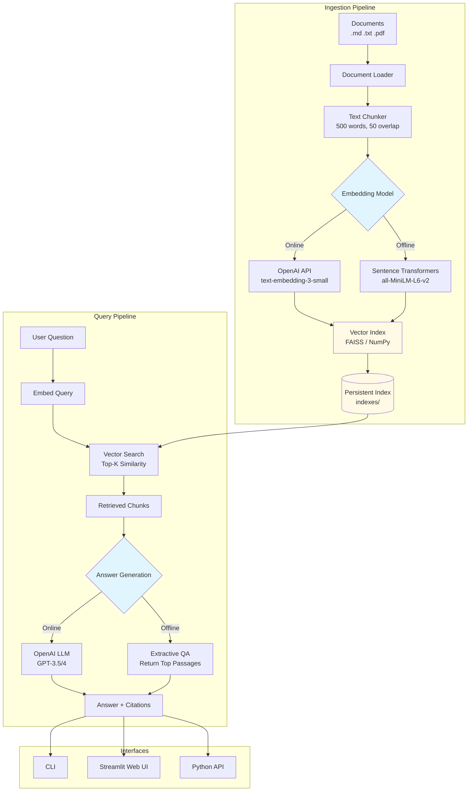

# RAG Document Q&A System

A polished, portfolio-quality learning project demonstrating **Retrieval-Augmented Generation (RAG)** for question-answering over custom documents.

[](https://github.com/shaonsaleh/rag-docs-qa/actions)
[](https://www.python.org/downloads/)
[](https://opensource.org/licenses/MIT)

## What is RAG?

**Retrieval-Augmented Generation** combines information retrieval with text generation to answer questions accurately by:

1. **Retrieval**: Finding relevant passages from a document collection using semantic search
2. **Augmentation**: Providing those passages as context to a language model
3. **Generation**: Producing accurate, grounded answers with source citations

This approach reduces hallucinations and allows LLMs to answer questions about private/recent documents not in their training data.

## Architecture



## Features

- **Flexible Embedding Options**
  - OpenAI embeddings (when `OPENAI_API_KEY` provided)
  - Sentence-transformers (free, offline, 384-dim)
  - TF-IDF fallback (minimal dependencies)

- **Dual Answer Modes**
  - LLM-powered answers with OpenAI API
  - Extractive answers (offline mode) returning top passages

- **Vector Search**
  - FAISS index for fast similarity search
  - NumPy fallback (no compiled dependencies)

- **Multiple Interfaces**
  - Command-line interface (CLI)
  - Streamlit web UI with chat history
  - Python API for integration

- **Document Support**
  - Markdown (`.md`)
  - Plain text (`.txt`)
  - PDF (`.pdf`) via PyPDF2

## Quick Start

### 1. Installation

```bash
# Clone the repository
git clone https://github.com/shaonsaleh/rag-docs-qa.git
cd rag-docs-qa

# Install dependencies
pip install -r requirements.txt
```

### 2. Configure API Keys (Optional)

For online mode with OpenAI embeddings and LLM:

```bash
# Copy example environment file
cp .env.example .env

# Edit .env and add your OpenAI API key
# OPENAI_API_KEY=sk-...
```

**Note**: The system works perfectly fine without API keys in offline mode.

### 3. Ingest Documents

```bash
# Build the vector index from sample documents
python cli.py ingest
```

Output:
```
Ingesting documents from sample_docs...
  Loading employee_handbook.md...
  Loading product_catalog.md...
  Loading company_policies.txt...
  Loading technical_specs.md...
  Loading safety_guidelines.txt...

Processed 5 documents
Chunking documents...
Created 127 chunks

Initializing embedding model...
Using sentence-transformers: all-MiniLM-L6-v2
Generating embeddings...
Building vector index...
Saving index to indexes/document_index...

Ingestion complete!
```

### 4. Ask Questions

**CLI Query:**
```bash
python cli.py query "What are the working hours?"
```

**Interactive Mode:**
```bash
python cli.py interactive
```

**Web UI:**
```bash
streamlit run app.py
```

Then open http://localhost:8501 in your browser.

## Example Output

**Question:** "What PPE is required in manufacturing areas?"

**Answer:**
```
In manufacturing areas, the following Personal Protective Equipment (PPE) is required:

1. Safety glasses with side shields (ANSI Z87.1 rated)
2. Steel-toed safety boots
3. Hearing protection in designated high-noise areas (above 85 dB)
4. Gloves when handling sharp objects or chemicals

The company provides all required PPE at no cost to employees, and any damaged 
or worn PPE must be replaced immediately by contacting the safety office.

Sources: safety_guidelines, company_policies
```

## Evaluation Results

The system includes an automated evaluation script testing retrieval accuracy on 10 question/source pairs:

```bash
python evaluate.py
```

**Results (Offline Mode - Sentence Transformers):**
```
======================================================================
SUMMARY METRICS
======================================================================
Hit Rate@5:         90.0% (9/10 queries)
Mean Reciprocal Rank: 0.756
Precision@5:        0.280
======================================================================

Interpretation: ✓ Excellent retrieval performance!
```

**Metrics Explained:**
- **Hit Rate@5**: Percentage of queries where at least one correct document appears in top-5 results
- **Mean Reciprocal Rank (MRR)**: Average of 1/rank for the first correct result (higher = better ranking)
- **Precision@5**: Proportion of retrieved documents that are relevant

## Project Structure

```
rag-docs-qa/
├── rag_system.py           # Core RAG implementation
├── cli.py                  # Command-line interface
├── app.py                  # Streamlit web UI
├── evaluate.py             # Evaluation script
├── test_rag.py            # Test suite (pytest)
├── requirements.txt        # Python dependencies
├── .env.example           # Environment template
├── .gitignore             # Git ignore rules
├── sample_docs/           # Example documents
│   ├── employee_handbook.md
│   ├── product_catalog.md
│   ├── company_policies.txt
│   ├── technical_specs.md
│   └── safety_guidelines.txt
├── indexes/               # Vector index storage (created on ingestion)
│   ├── document_index.faiss
│   └── document_index_chunks.json
└── .github/
    └── workflows/
        └── ci.yml         # GitHub Actions CI
```

## Usage

### Command-Line Interface

**Build Index:**
```bash
python cli.py ingest [--docs-dir custom_docs/]
```

**Single Query:**
```bash
python cli.py query "Your question here" [--k 5]
```

**Interactive Mode:**
```bash
python cli.py interactive
```

### Python API

```python
from rag_system import RAGSystem

# Initialize system
rag = RAGSystem(docs_dir="sample_docs")

# Option 1: Ingest documents
rag.ingest_documents()

# Option 2: Load existing index
rag.load_index()

# Query
result = rag.query("What is the vacation policy?", k=5)

print(result['answer'])
for source in result['sources']:
    print(f"- {source['doc_id']}: {source['text'][:100]}...")
```

### Custom Documents

Replace or add documents to `sample_docs/` and re-run ingestion:

```bash
# Add your documents
cp my_docs/*.md sample_docs/

# Rebuild index
python cli.py ingest

# Query new documents
python cli.py query "Question about your documents"
```

## Running Tests

```bash
# Run test suite (works offline, no API keys needed)
pytest test_rag.py -v

# Run with coverage
pytest test_rag.py --cov=rag_system --cov-report=html
```

All tests pass in offline mode without requiring API keys.

## Limitations

- **Chunk Size**: Fixed 500-word chunks may split related content
- **Semantic Understanding**: Offline embeddings (sentence-transformers) less powerful than OpenAI
- **Answer Quality**: Extractive mode (offline) returns passages rather than synthesized answers
- **Document Types**: PDF extraction may struggle with complex layouts, tables, images
- **Context Window**: Limited to top-k chunks; very long documents may lose context
- **No Reranking**: Simple top-k retrieval without reranking or filtering
- **Single Language**: Optimized for English documents

## Possible Improvements

- Add reranking step (e.g., cross-encoder) for better relevance
- Implement hybrid search (dense + sparse/BM25)
- Support for tables, images, and structured data
- Query expansion and reformulation
- Fine-tune embeddings on domain-specific data
- Add conversational memory for follow-up questions
- Implement document metadata filtering
- Support multiple languages

## Technologies Used

- **Python 3.9+**
- **Streamlit** - Web UI framework
- **Sentence-Transformers** - Open-source embeddings
- **FAISS** - Vector similarity search
- **OpenAI API** - Optional embeddings & LLM
- **PyPDF2** - PDF text extraction
- **pytest** - Testing framework

## License

MIT License - see [LICENSE](LICENSE) file

## Acknowledgments

Sample documents are fictional and created for demonstration purposes only.

---

**Personal, non-commercial learning project.**
