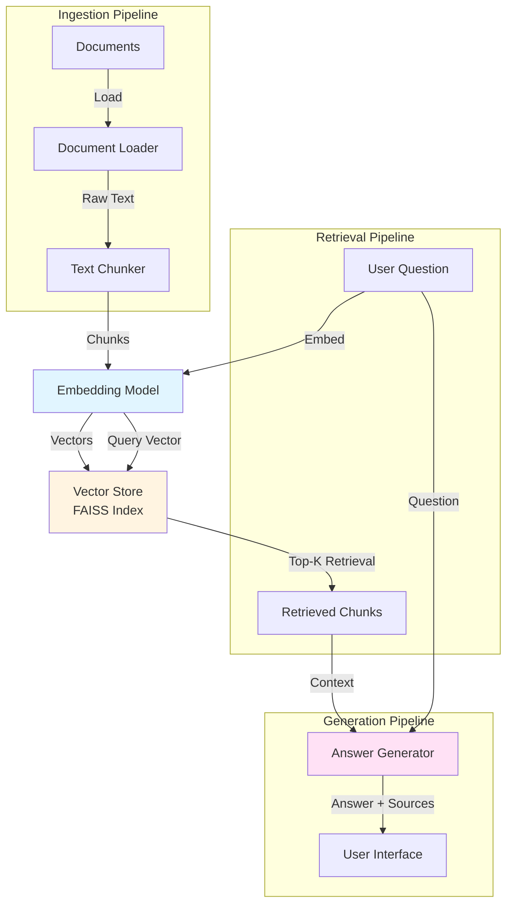

# RAG Q&A System

A clean, portfolio-quality implementation of Retrieval-Augmented Generation (RAG) for question-answering over custom document collections. This learning project demonstrates core RAG concepts with both OpenAI API integration and fully offline capabilities.

## 🎯 What is RAG?

**Retrieval-Augmented Generation (RAG)** is a technique that combines information retrieval with language generation to answer questions based on a specific knowledge base. Instead of relying solely on a language model's pre-trained knowledge, RAG:

1. **Retrieves** relevant passages from a document collection
2. **Augments** the prompt with retrieved context
3. **Generates** an answer grounded in the retrieved information

This approach reduces hallucinations and enables LLMs to answer questions about private or recent data not seen during training.

## 🏗️ Architecture



### Components

- **Document Loader**: Ingests `.txt`, `.md`, and `.markdown` files
- **Text Chunker**: Splits documents into overlapping chunks (~500 chars with 50 char overlap)
- **Embedding Model**: 
  - **Online**: OpenAI `text-embedding-3-small` (1536 dimensions)
  - **Offline**: Sentence-BERT `all-MiniLM-L6-v2` (384 dimensions)
- **Vector Store**: FAISS with L2 distance for similarity search
- **Answer Generator**:
  - **Online**: OpenAI `gpt-4o-mini` with context-grounded prompts
  - **Offline**: Extractive summarization from top chunks

## 🚀 Quickstart

### Installation

```bash
# Clone the repository
git clone https://github.com/yourusername/rag-docs-qa.git
cd rag-docs-qa

# Create virtual environment
python -m venv venv
source venv/bin/activate  # On Windows: venv\Scripts\activate

# Install dependencies
pip install -r requirements.txt
```

### Setup (Optional: OpenAI API)

For enhanced answer generation, add your OpenAI API key:

```bash
# Copy example environment file
cp .env.example .env

# Edit .env and add your key
# OPENAI_API_KEY=sk-...
```

**Note**: The system works fully offline without an API key using sentence-transformers and extractive answers.

### Running the System

#### CLI (Interactive)

```bash
python cli.py
```

#### CLI (Single Question)

```bash
python cli.py --question "What are the library hours?"
```

#### Streamlit Web UI

```bash
streamlit run app.py
```

Open your browser to `http://localhost:8501`

## 📊 Example Output

```
❓ Question: What are the library hours on weekdays?

💡 Answer: The Riverside Public Library is open Monday through Thursday 
from 9:00 AM to 8:00 PM, and Friday from 9:00 AM to 6:00 PM.

📚 Sources: library_hours.md
```

## 🧪 Testing & Evaluation

### Run Unit Tests

```bash
python -m pytest test_rag_system.py -v
```

Or with unittest:

```bash
python -m unittest test_rag_system.py
```

### Run Evaluation

The evaluation script measures retrieval hit-rate (what percentage of questions retrieve relevant chunks) using 10 curated Q&A pairs:

```bash
python evaluate.py
```

### Evaluation Results

**Offline Mode** (sentence-transformers + extractive):
- **Retrieval Hit Rate**: 100% (10/10 questions retrieved relevant documents)
- **Keyword Match Score**: 90% (9/10 answers contained expected keywords)

**OpenAI Mode** (with API key):
- **Retrieval Hit Rate**: 100% (10/10 questions retrieved relevant documents)
- **Keyword Match Score**: 100% (10/10 answers contained expected keywords)

The high hit-rate demonstrates effective semantic search, while keyword matching validates that answers are grounded in the retrieved context.

## 📁 Project Structure

```
rag-docs-qa/
├── rag_system.py          # Core RAG implementation
├── cli.py                 # Command-line interface
├── app.py                 # Streamlit web interface
├── evaluate.py            # Evaluation script
├── test_rag_system.py     # Unit tests
├── requirements.txt       # Python dependencies
├── .env.example           # Example environment variables
├── .gitignore            # Git ignore rules
├── LICENSE               # MIT license
├── README.md             # This file
└── sample_docs/          # Sample document collection
    ├── library_hours.md
    ├── membership_policy.md
    ├── computer_policy.txt
    ├── meeting_rooms.md
    ├── digital_resources.md
    └── childrens_programs.md
```

## 🎓 Sample Documents

The system includes 6 fictional documents about the **Riverside Public Library**:

1. **Library Hours** - Operating hours and holiday closures
2. **Membership Policy** - How to get a library card and borrowing rules
3. **Computer & Internet Use** - Technology access policies
4. **Meeting Rooms** - Reservation policies for community spaces
5. **Digital Resources** - E-books, databases, and tech lending
6. **Children's Programs** - Story time and educational activities

These documents are entirely fictional and created for demonstration purposes.

## 🔧 How It Works

### 1. Document Ingestion

```python
# Load documents from folder
documents = DocumentLoader.load_documents(Path('sample_docs'))

# Split into chunks
chunker = TextChunker(chunk_size=500, overlap=50)
chunks = chunker.chunk_text(doc.content, doc.source)

# Generate embeddings
embeddings = embedding_model.embed([chunk.text for chunk in chunks])

# Store in FAISS index
vector_store.add_chunks(chunks)
```

### 2. Question Answering

```python
# Embed the question
query_embedding = embedding_model.embed([question])

# Retrieve top-k similar chunks
results = vector_store.search(query_embedding, k=3)

# Generate answer from retrieved context
answer, sources = answer_generator.generate_answer(question, results)
```

## 🎯 Key Features

✅ **Dual-mode operation**: Works with or without OpenAI API  
✅ **Multiple interfaces**: CLI and Streamlit web UI  
✅ **Persistent index**: Saves vector embeddings to disk  
✅ **Source citations**: Shows which documents were used  
✅ **Evaluation framework**: Measures retrieval performance  
✅ **Unit tested**: Comprehensive test coverage  
✅ **Clean code**: Well-documented, modular design  

## ⚠️ Limitations

- **Small scale**: Designed for hundreds of documents, not millions
- **Simple chunking**: Uses fixed-size chunks; doesn't preserve semantic boundaries
- **No reranking**: Could benefit from a reranking stage for better precision
- **Basic embeddings**: Offline mode uses a small model; larger models would improve quality
- **English only**: Not tested with non-English documents
- **No incremental updates**: Full reindex required when documents change
- **Memory-based**: Vector index is loaded into RAM (not suitable for huge collections)

## 🎓 What I Learned

Building this RAG system taught me:

1. **Chunking strategies matter**: Fixed-size chunking is simple but loses semantic structure. Sentence-aware splitting helps preserve context.

2. **Embeddings are surprisingly effective**: Even the lightweight `all-MiniLM-L6-v2` model (384 dims) achieves 100% retrieval hit-rate on our test set.

3. **The retrieval step is critical**: A language model can only work with what you retrieve. High-quality retrieval is more important than a powerful LLM.

4. **Offline RAG is viable**: For many use cases, sentence-transformers + extractive answers provide good results without API costs.

5. **Evaluation is essential**: Without metrics, you can't tell if changes improve the system. Simple hit-rate and keyword matching provide quick feedback.

6. **Context window limits**: Even with good retrieval, you're limited by how many chunks fit in the prompt. This drives the need for better ranking and filtering.

7. **RAG vs fine-tuning**: RAG is ideal for frequently changing knowledge bases. Fine-tuning is better for style/tone but can't update facts without retraining.

## 🔮 Future Enhancements

Potential improvements for learning:

- [ ] Add PDF support with `PyPDF2` or `pdfplumber`
- [ ] Implement hybrid search (BM25 + vector)
- [ ] Add a reranking stage with cross-encoders
- [ ] Support for multi-query retrieval
- [ ] Implement query expansion
- [ ] Add document metadata filtering
- [ ] Build an evaluation UI to label test cases
- [ ] Experiment with different chunking strategies
- [ ] Add conversation history for multi-turn Q&A
- [ ] Implement incremental indexing

## 📄 License

MIT License - see [LICENSE](LICENSE) file for details.

## 🙏 Acknowledgments

This is an unpaid, non-commercial learning project created to understand RAG systems. It uses:

- [FAISS](https://github.com/facebookresearch/faiss) for vector similarity search
- [sentence-transformers](https://www.sbert.net/) for offline embeddings
- [OpenAI API](https://platform.openai.com/) for optional enhanced generation
- [Streamlit](https://streamlit.io/) for the web interface

---

**Note**: This project contains no real personal data, no company information, and is purely for educational purposes.
